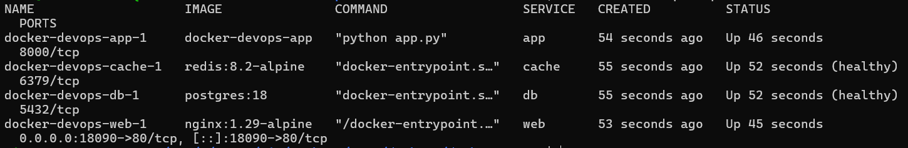
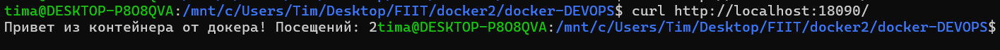
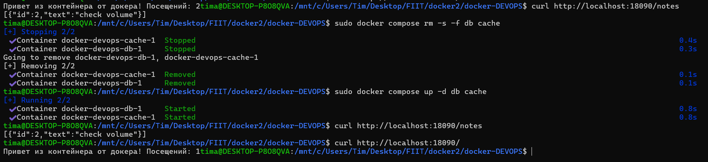
PostgreSQL: подключён именованный volume pgdata. Контрольная запись сохранилась после пересоздания контейнера БД, что подтвердило сохранность данных.

Redis: используется для временного счётчика посещений. Volume не подключён, поэтому потеря счётчика при пересоздании контейнера допустима.
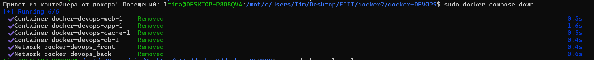
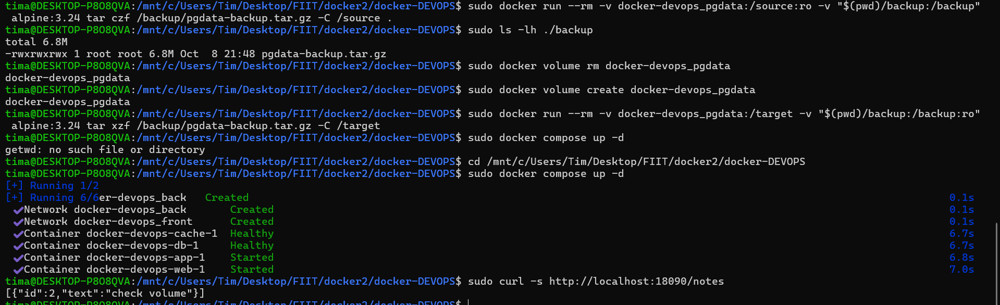
1. Остановил стек командой sudo docker compose down.
2. Создал архив содержимого именованного volume docker-devops_pgdata во внешнем каталоге backup.
3. Проверил наличие архива pgdata-backup.tar.gz.
4. Удалил исходный volume, создал его заново и восстановил данные из архива.
5. Поднял стек снова
6. Проверил данные через GET /notes.
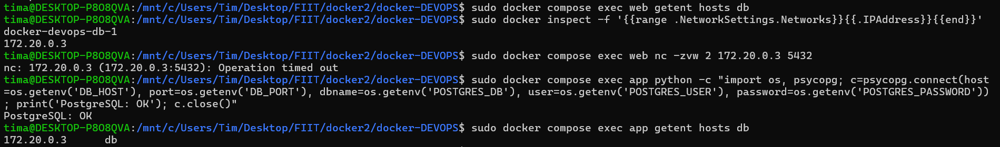
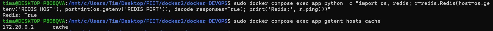
Flask не пересылает IP-пакеты между сетями. Он получает HTTP-запрос от Nginx и уже самостоятельно создаёт новое соединение с БД или кешем.

По умолчанию Compose берёт имя проекта из названия директории, в которой находится Compose-файл. Главный принцип: явно заданное значение имеет больший приоритет. Compose строит имена контейнеров, сетей и тома из имени проекта и имени ресурса. Для контейнеров ещё добавляется номер экземпляра.
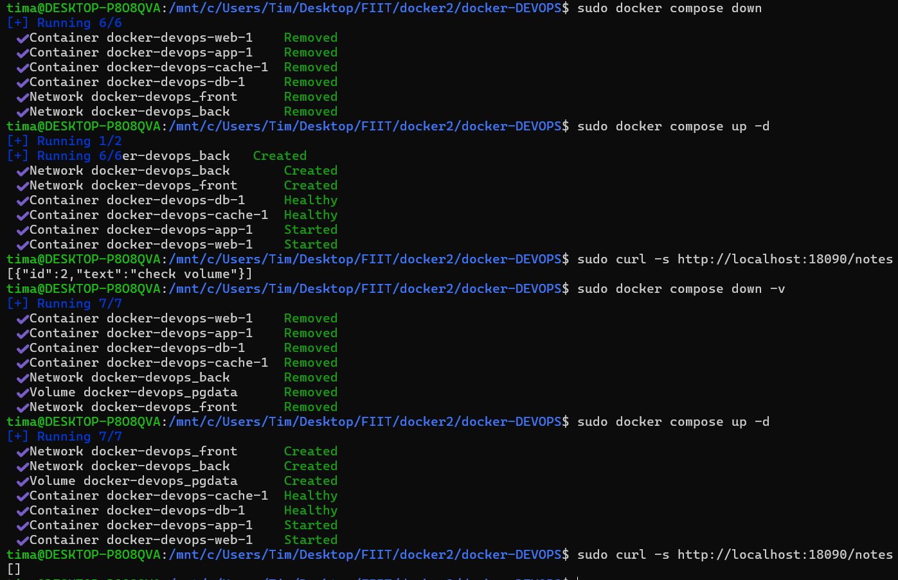

Версии инструментов:

Docker — 28.5.1
Docker Compose — v2.40.0-desktop.1
Dive — 0.13.1

До оптимизации:

Базовый образ: python:3.13
Размер: 1.2 GB
Wasted space: 10 MB
Efficiency: 99%

Results:
  PASS: highestUserWastedPercent
  SKIP: highestWastedBytes: rule disabled
  PASS: lowestEfficiency
  
Оптимизация:

В Dockerfile базовый образ заменён:

FROM python:3.13

на:

FROM python:3.13-slim

Остальные инструкции Dockerfile не изменялись.

После оптимизации:

Базовый образ: python:3.13-slim
Размер: 170 MB
Wasted space: 5.7 MB
Efficiency: 97%

Results:
  PASS: highestUserWastedPercent
  SKIP: highestWastedBytes: rule disabled
  PASS: lowestEfficiency

Размер образа уменьшился примерно в 7 раз: с 1.2 GB до 170 MB.

до
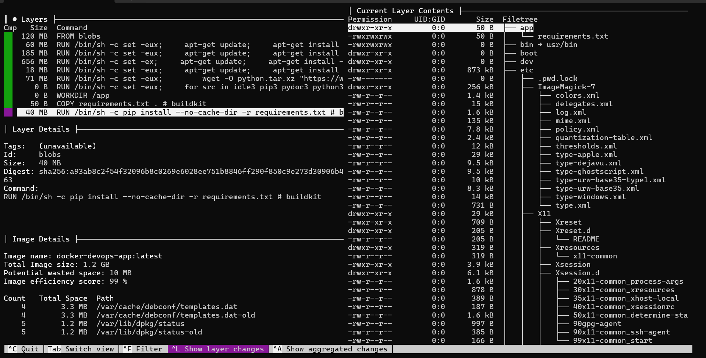
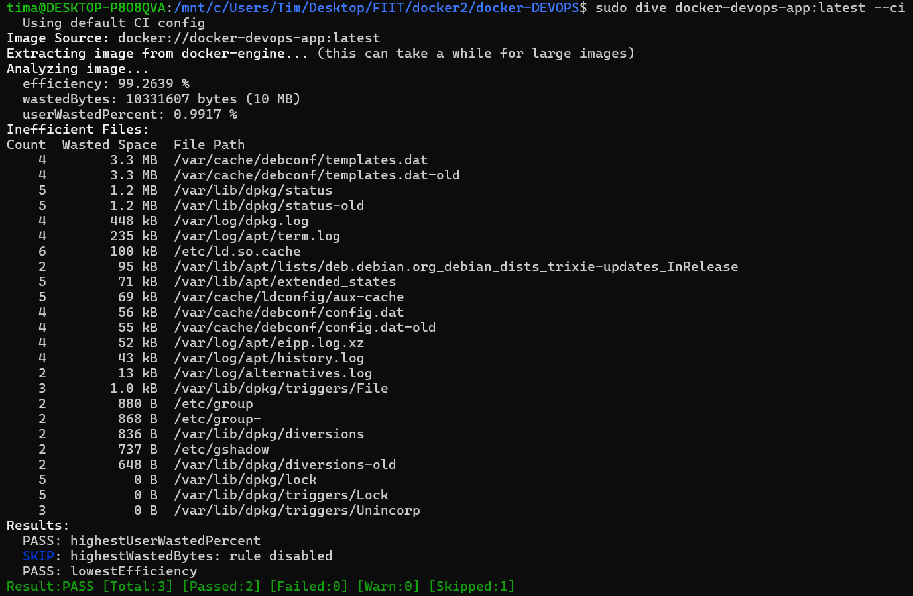
после
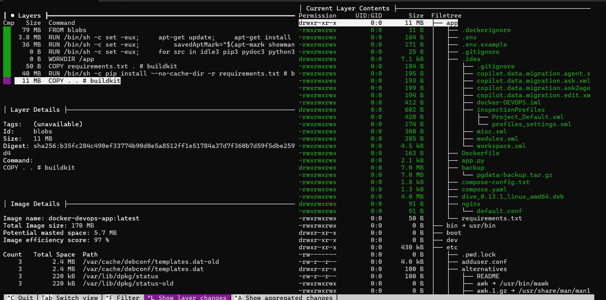
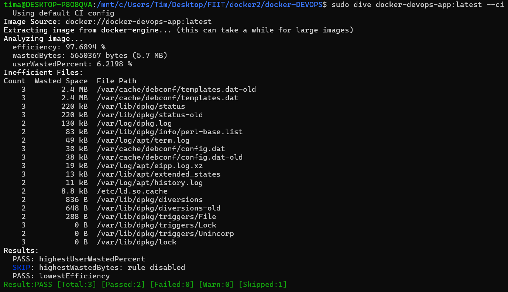
